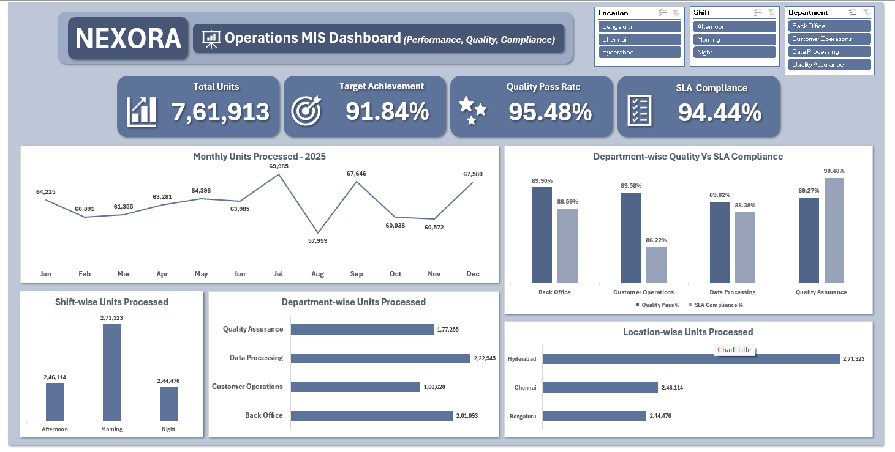

# 📊 Nexora Operations – MIS Reporting Dashboard

## 📋 Project Overview

The **Nexora Operations MIS Reporting Project** is a Microsoft Excel reporting solution designed to monitor operational performance, productivity, quality, and SLA compliance across multiple departments, shifts, and locations.

The project demonstrates how raw operational data can be cleaned, validated, analyzed, and transformed into an interactive management dashboard using Microsoft Excel.

---

## 📊 Preview

## 🏢 Business Scenario

**Nexora Operations Services** is a fictional operations organization with multiple departments, teams, shifts, and operational locations.

Management requires a centralized reporting solution to monitor employee-level operational performance and identify trends, performance gaps, and areas requiring improvement.

This project simulates that reporting requirement using **2025 operational data**.

---

## 🎯 Project Objectives

- Clean and validate raw operational data.
- Identify and correct data quality issues.
- Calculate key operational performance indicators.
- Analyze performance across departments, employees, months, shifts, and locations.
- Build an interactive MIS dashboard.
- Enable dynamic reporting through Excel slicers.

---

## 🗂️ Dataset Overview

- **Reporting period:** January–December 2025
- **Original operational records:** 10,000
- **Unique records after duplicate removal:** 9,995
- **Employee master records:** 40
- **Departments:** 4
- **Teams:** 8
- **Shifts:** 3
- **Locations:** 3

> *Note: Each operational record represents one employee's performance on one scheduled working day.*

---

## 📑 Excel Workbook Structure

| Worksheet | Purpose |
| :--- | :--- |
| `Employee_Master` | Employee reference information |
| `Raw_Data` | Original operational dataset |
| `Cleaned_Data` | Validated and cleaned dataset |
| `Calculations` | KPI calculations |
| `Pivot_Analysis` | Detailed operational analysis |
| `Pivots for Charts` | Supporting chart PivotTables |
| `MIS_Dashboard` | Interactive management dashboard |

---

## 📈 Key Performance Indicators (KPIs)

1. **Total Units Processed**
2. **Target Achievement %**
3. **Productivity %**
4. **Quality Pass %**
5. **Error Rate %**
6. **SLA Compliance %**
7. **Attendance %**

---

## 🖥️ Dashboard Features

- Dynamic KPI cards
- Monthly operational output trend
- Department-wise performance analysis
- Shift-wise performance analysis
- Location-wise performance analysis
- Quality vs. SLA compliance comparison
- Interactive Department, Shift, and Location slicers
- Dynamic KPI calculations responding to slicer selections

---

## 🧹 Data Cleaning and Validation

The raw dataset contained duplicate records, missing employee information, inconsistent text values, and invalid numerical entries.

The cleaning process included:

- Duplicate record removal
- Missing employee ID recovery using the Employee Master
- Missing employee name recovery using lookup formulas
- Text standardization
- Numerical validation and correction
- Final data quality checks

*The original raw dataset was preserved separately from the cleaned dataset.*

---

## 🛠️ Tools and Excel Skills Demonstrated

- Microsoft Excel
- Excel Tables and structured references
- Data cleaning and validation
- `XLOOKUP`
- `IFERROR`, `SUMIFS`, `COUNTIF`, `COUNTA`, `COUNTBLANK`, `SUMPRODUCT`
- Excel PivotTables and PivotCharts
- Slicers and Report Connections
- KPI calculations
- Interactive dashboard development
- Data visualization and MIS reporting

---

## 🏆 Project Outcome

The project delivers a centralized and interactive Excel MIS dashboard that allows management to analyze operational performance across different reporting dimensions.

It demonstrates practical Excel capabilities relevant to MIS reporting, operations analysis, and reporting executive roles.

---

## 📌 Project Details

- **Project Type:** Portfolio Project – Operations MIS Reporting
- **Organization:** Nexora Operations Services *(Fictional)*
- **Reporting Period:** January–December 2025
- **Technology:** Microsoft Excel

[def]: Schreenshots/MIS_Dashboard.png